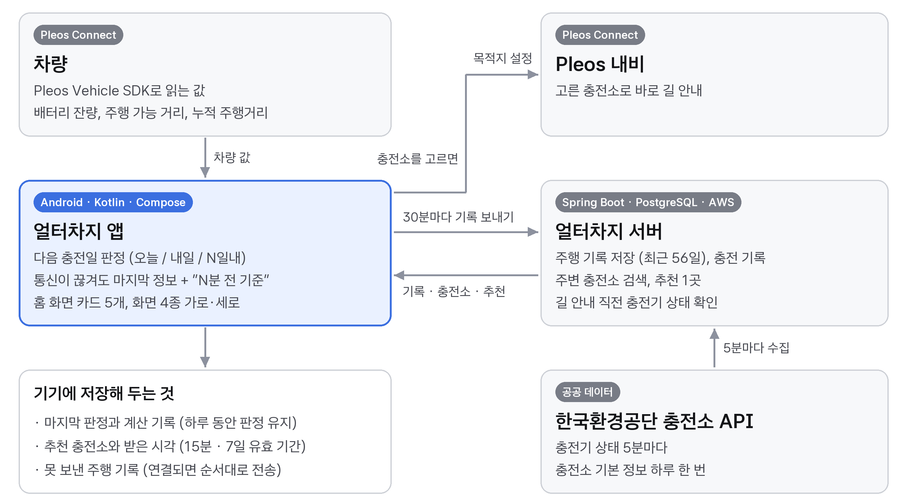

  

차량 데이터로 **다음 충전일을 먼저 알려 주고**, 충전할 곳까지 차 안에서 정하게 해 주는 Pleos Connect 전기차 서비스입니다.
현대자동차그룹 차량용 앱 개발 공모전 출품작입니다.

## 무엇을 하나요

- **언제 충전할지**: 배터리 잔량과 최근 14일 주행 기록으로 "오늘 충전 / 내일 충전 / N일내 충전"을 판정합니다.
- **어디서 충전할지**: 주변 충전소와 빈 충전기 수를 보여 주고, 추천 충전소 1곳을 따로 알려 줍니다.
- **바로 출발**: 충전소를 고르면 길 안내 직전에 충전기 상태를 한 번 더 확인하고 Pleos 내비 목적지로 넘깁니다.
- **끊겨도 그대로**: 통신이 끊겨도 마지막 판정과 충전소 정보를 "N분 전 기준"과 함께 보여 주고, 못 보낸 주행 기록은 연결되면 다시 보냅니다.

## 전체 구성

## 저장소

| 저장소 | 맡은 일 | 기술 |
|---|---|---|
| [altercharge-app](https://github.com/2026-Hyundai-Car-Contest/altercharge-app) | 차량 앱. 차량 값 읽기, 다음 충전일 판정, 홈 화면 카드, 오프라인 표시 | Kotlin, Jetpack Compose, Pleos Vehicle SDK |
| [altercharge-server](https://github.com/2026-Hyundai-Car-Contest/altercharge-server) | 서버. 주행·충전 기록 저장, 충전소 검색과 추천, 충전기 상태 수집 | Spring Boot, PostgreSQL, AWS |

앱 실행 방법과 제출용 APK는 [altercharge-app](https://github.com/2026-Hyundai-Car-Contest/altercharge-app), API 명세는 [altercharge-server](https://github.com/2026-Hyundai-Car-Contest/altercharge-server)에 있습니다.
